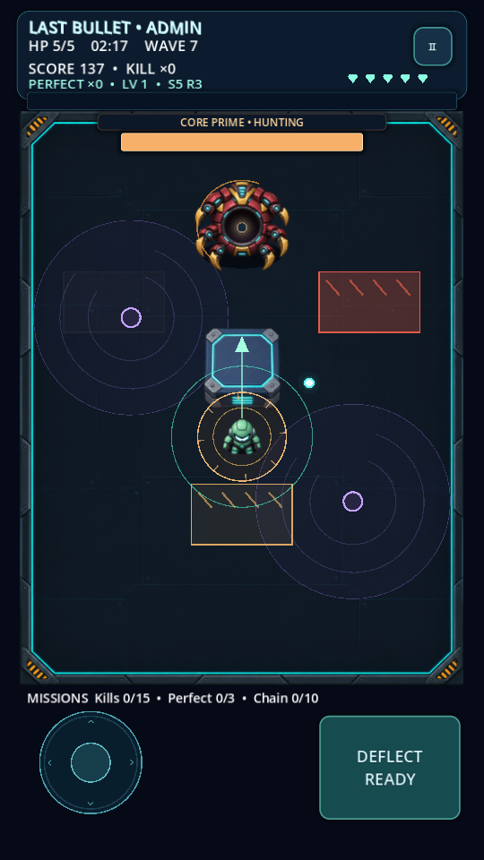

# LAST-BULLET

**v0.6.0 — Five-stage Campaign & Robot Summon**

Open `last-bullet/project.godot` in Godot 4.6.3 → F5. Close Godot before GitHub Desktop Fetch/Pull.

- **PLAY → CAMPAIGN:** five themed arenas, three combat waves each, five illustrated bosses, stars and stage unlocks.
- **SUMMON:** ×1/×10 ticket pulls, 75/20/5 base rates, 10/50 pity, duplicate shards and targeted exchanges. Existing owned robots stay owned.
- **ADMIN:** all stages/robots/skins open, free summons, god mode and test labs; normal save stays separate.
- Instant x2 gold, Survival and Blitz remain available. No payments or ads.

[Full Campaign & Summon guide](last-bullet/docs/CAMPAIGN_SUMMON.md) · [Campaign selection](last-bullet/docs/previews/v0.6-campaign.png) · [Summon screenshot](last-bullet/docs/previews/v0.6-summon.png) · [Validation](last-bullet/docs/TEST_RESULTS.md)

