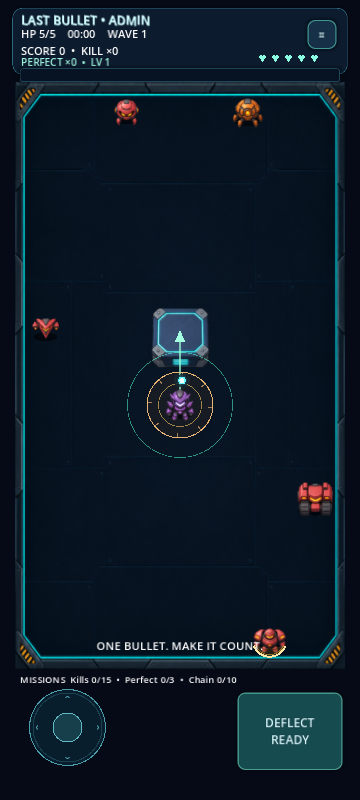

# LAST-BULLET

**v0.5.0 — Admin, adaptive mobile layout and 7 robots**

Godot 4.6.3 → open `last-bullet/project.godot` → F5. Close Godot before GitHub Desktop Fetch/Pull.

**Unlock everything:** Menu → ADMIN → ENABLE ADMIN. Free robots/skins, god mode, upgrade/enemy labs and boss test. Normal progress is saved separately.

**Characters:** Aegis, Volt, Frost, Ember, Nova, Cobalt and Scout. Choose under ROBOTS.

Larger buttons/text, taller-phone arena, safe-area-aware controls; desktop window 540×960 and F11 fullscreen.

[Guide](last-bullet/README.md) · [Robot Hangar screenshot](last-bullet/docs/previews/v0.5-robots.png) · [Admin screenshot](last-bullet/docs/previews/v0.5-admin.png) · [Validation](last-bullet/docs/TEST_RESULTS.md)

