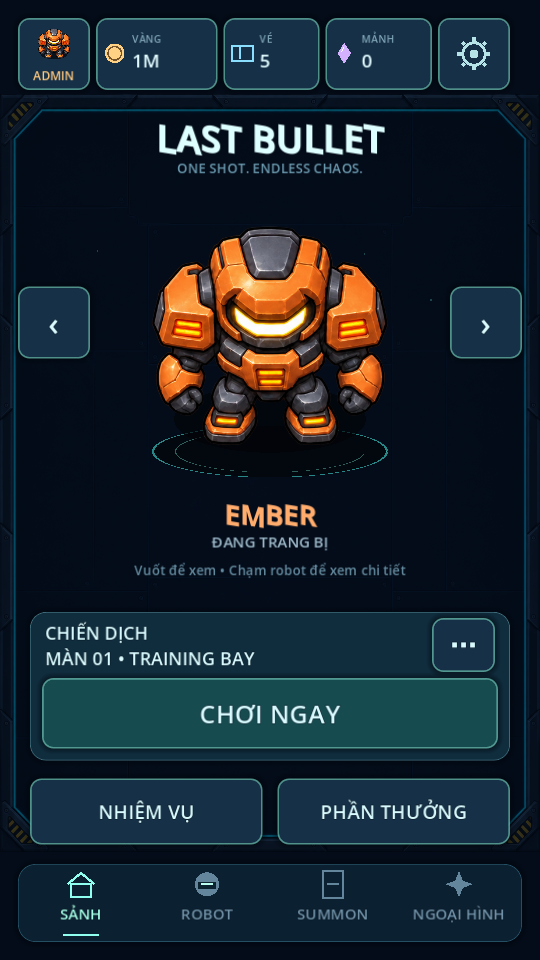

# LAST-BULLET

**v0.7.0 — Mobile lobby, Campaign & Robot Summon**

Mở `last-bullet/project.godot` bằng Godot 4 (đã kiểm tra trên 4.6.3).
Robot lớn để vuốt xem, nút Chơi ngay và thanh dưới Sảnh / Robot / Summon / Ngoại hình. Admin nằm trong avatar góc trái trên.

- 5 màn chiến dịch, boss riêng, sao và mở khóa.
- Summon ×1/×10, pity, robot trùng thành mảnh và đổi robot.
- Admin local tách tiến trình thường; x2 vàng nhận ngay, không quảng cáo.

## Tiếp tục ở phiên chat sau

Đọc [AGENTS.md](AGENTS.md) và [bàn giao trạng thái dự án](last-bullet/docs/SESSION_HANDOFF.md).
[Quy trình Godot Android + Termux/Git trên S23 Ultra](last-bullet/docs/ANDROID_TERMUX.md).

Cập nhật trên điện thoại: đóng dự án Godot, chạy trong Termux:

```bash
cd ~/storage/downloads/GodotProjects/LAST-BULLET
git pull --ff-only
```

Mở lại Godot; không cần tải ZIP/import lại. Trên PC cũng đóng Godot trước Fetch/Pull. Nếu Git báo xung đột, bảo toàn thay đổi trước khi xử lý.

[Hướng dẫn đầy đủ](last-bullet/README.md) · [Campaign & Summon](last-bullet/docs/CAMPAIGN_SUMMON.md) · [Kết quả kiểm tra](last-bullet/docs/TEST_RESULTS.md)


