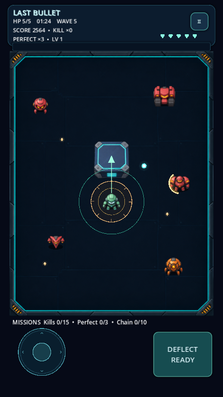

# LAST-BULLET

**v0.4.0 — Neon Arcade graphics update**

Open `last-bullet/project.godot` in Godot 4.6.3, wait for art import, then press F5. GitHub Desktop: Fetch origin → Pull origin.

[Game and controls](last-bullet/README.md) · [8-second motion preview (MP4)](last-bullet/docs/previews/v0.4-motion.mp4) · [Boss screenshot](last-bullet/docs/previews/v0.4-boss.png) · [Validation](last-bullet/docs/TEST_RESULTS.md)

Full illustrated robot roster, metal arena, animated skins, boss effects and neon UI. Includes Survival, Reflector, 90-second Blitz and instant admin x2 gold after a run.
