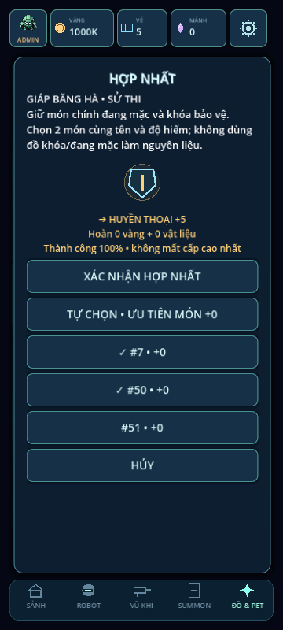
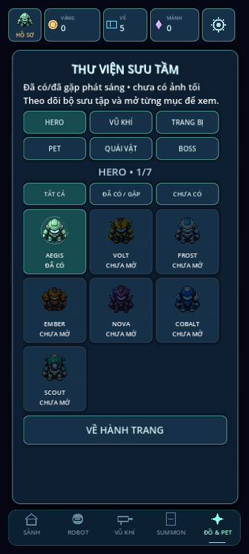

# LAST BULLET — v1.0.0

Robot survival shooter cho Godot4 (kiểm tra trên4.6.3), thiết kế màn hình dọc.

**Đã có trang bị, hợp nhất, pet, phó bản theo phòng và càn quét.** Giữ12 vũ khí/16 nâng cấp, kéo để né–thả tay bắn (tùy chọn bắn khi chạy), nhấn đúp dùng skill.

Vào **ĐỒ & PET** ở sảnh:

- 12 mẫu trang bị,4 ô/4 độ hiếm,+0…+10; hợp nhất3→1 đảm bảo, bảo vệ đồ khóa/đang mặc và hoàn đầu tư dư.
- 6 pet tự hỗ trợ,3 bộ lưu sẵn và thưởng bộ2/4 món.
- 5 ải×5 phòng, Thường/Khó, lưu/tiếp tục build, giữ loot khi thua.
- Càn quét1/5/10 theo3 sao, vé ngày/nhiệm vụ; admin miễn vé.
- Thư viện sưu tầm sáng/tối theo sở hữu/đã gặp; thử đồ đo DPS10s không trả thưởng.

[Hướng dẫn chơi](last-bullet/README.md) · [Hệ thống RPG đầy đủ](last-bullet/docs/RPG_SYSTEMS.md) · [Kho vũ khí](last-bullet/docs/ARSENAL.md) · [17 bộ kiểm tra](last-bullet/docs/TEST_RESULTS.md)




Mở last-bullet/project.godot. Đóng dự án Godot trước khi cập nhật. Termux trên S23 Ultra:

```bash
cd ~/storage/downloads/GodotProjects/LAST-BULLET
git pull --ff-only
```

[Quy trình Android/Termux](last-bullet/docs/ANDROID_TERMUX.md). Phiên chat sau đọc [AGENTS.md](AGENTS.md) và [bàn giao](last-bullet/docs/SESSION_HANDOFF.md).

Giữ tiến trình thường/admin riêng, robot/skin/summon/pity/campaign cũ. Admin mở48 biến thể đồ+6pet, nâng miễn phí. X2 vàng nhận ngay một lần; không quảng cáo/thanh toán. Chưa benchmark FPS/nhiệt hoặc kiểm thử bản RPG trên điện thoại thật.
