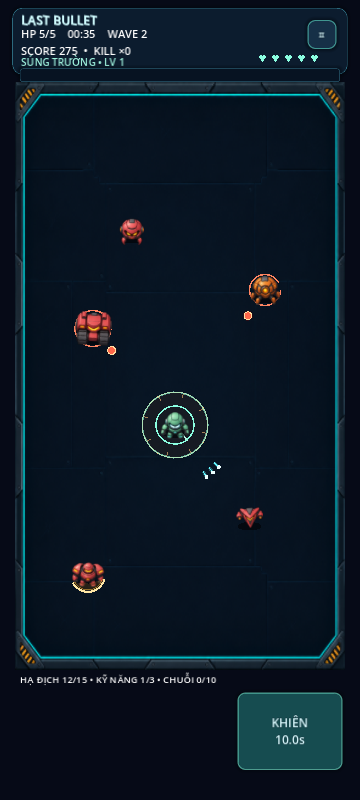

# LAST BULLET — v0.8.0
ZORVYKA Games • Auto Fire. Endless Chaos.

Godot 4 portrait robot survival shooter. Open `last-bullet/project.godot` from the repository root (or `project.godot` when already inside this directory). Validated with Godot 4.6.3.

## Chơi trên điện thoại
Kéo ở bất kỳ vùng trống nào để di chuyển. Chạm đơn không kích hoạt; cần ẩn xuất hiện sau khi kéo ít nhất 12 pixel logic. Robot tự chọn địch gần trong tầm có đường bắn thông thoáng và tự bắn cả khi di chuyển. Đạn bạn màu sáng; né đạn đỏ/cam và vùng báo động của địch.

Bấm nút kỹ năng bên phải (Space trên PC). WASD/phím mũi tên di chuyển, Esc tạm dừng, F11 fullscreen cửa sổ desktop. Đã bỏ hoàn toàn gameplay Deflect, Perfect và viên đạn tồn tại mãi của v0.7.

## Robot, vũ khí và kỹ năng
| Robot | Vũ khí | Kỹ năng |
|---|---|---|
| Aegis | Súng trường | Khiên 3 giây, tối đa 3 lần chặn |
| Volt | Súng điện nhanh, nảy 1 mục tiêu | Xung điện quanh robot |
| Frost | Đạn băng làm chậm | Đóng băng/làm chậm vùng quanh robot |
| Ember | Phun lửa tầm ngắn, gây cháy | Bùng nổ lửa quanh robot |
| Nova | Laser xuyên 3 mục tiêu bổ sung | 12 tia laser tỏa tròn |
| Cobalt | Shotgun 5 viên | 7 tên lửa có dẫn hướng, nổ lan |
| Scout | Súng trinh sát tầm xa | Lướt theo hướng di chuyển/ngắm, bất tử ngắn |

Cùng 5 HP và hitbox; vũ khí/kỹ năng có khác biệt thực sự. Đạn thường hết tầm hoặc trúng tường/mục tiêu thì biến mất; nâng cấp xuyên/nảy chỉ thêm số lần hữu hạn, không có đạn bất tử.

## Nâng cấp và nhiệm vụ
8 nâng cấp: Hỏa lực, Tốc xạ, Đa đạn, Chí mạng, Đạn cháy, Xuyên giáp, Đạn liên hoàn, Hồi kỹ năng. Chọn một trong tối đa ba thẻ khi lên cấp; giao tranh dừng, HUD ẩn và có lớp chặn chạm. Thông số trước → sau lấy từ vũ khí đang dùng.

Mỗi trận có 3 nhiệm vụ: hạ 15 địch, dùng 3 kỹ năng, chuỗi hạ 10 địch trong khoảng 3 giây giữa các lần hạ. Mỗi mục tiêu tự trả 15 vàng + 1 vé đúng một lần. Kết quả hiển thị điểm/thời gian/số địch, phần thưởng, chi tiết bắn/trúng/chí mạng/kỹ năng. X2 vàng nhận ngay một lần cho trận vừa xong, đúng profile; không có quảng cáo thật hay mô phỏng.

## Màn chơi và summon
Giữ Survival, sân có trụ (tên preset legacy Reflector), Blitz 90 giây và 5 màn Campaign. Boss dùng bắn loạt, khiên theo chu kỳ, lao tới và vùng báo động; không bắt/trả đạn. [Chi tiết Campaign & Summon](docs/CAMPAIGN_SUMMON.md).

7 robot và 4 skin đạn hiện có được giữ. Summon x1/x10 bằng vé, tỷ lệ gốc 75/20/5, pity 10/50, robot trùng thành mảnh để đổi chọn. Skin đổi màu đạn thông thường, không tăng chỉ số; laser/băng/lửa vẫn giữ màu nhận diện.

## Admin, lưu và cập nhật
Avatar góc trái trên → Admin. Mở toàn bộ robot/skin/màn, summon miễn phí, test vàng, bật/tắt bất tử, max nâng cấp, bỏ hồi kỹ năng, phòng nâng cấp/địch/boss. Admin local tách tiến trình thường; không phải tài khoản máy chủ.

Giữ `user://records.cfg`, `records-admin.cfg`, `records-mode.cfg`. Vàng, robot, skin, summon/pity và campaign cũ không bị reset. Điểm Survival/Blitz của shooter dùng khóa mới, điểm gameplay cũ được giữ trong file nhưng không so kỷ lục chung.

Đóng dự án Godot trước khi cập nhật. Trên Termux:

```bash
cd ~/storage/downloads/GodotProjects/LAST-BULLET
git pull --ff-only
```

[Hướng dẫn Android/Termux](docs/ANDROID_TERMUX.md) · [Bàn giao](docs/SESSION_HANDOFF.md) · [Kiểm tra](docs/TEST_RESULTS.md) · [Cơ chế shooter](docs/SHOOTER.md)



Các tài liệu/ảnh phiên bản cũ là lịch sử. v0.8 thay thế luật một viên đạn/Deflect và robot chỉ khác ngoại hình. Bản này chưa benchmark điện thoại thật hoặc xuất APK.
