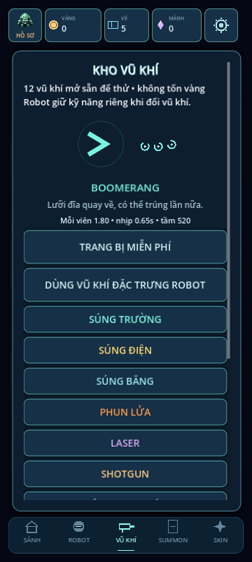
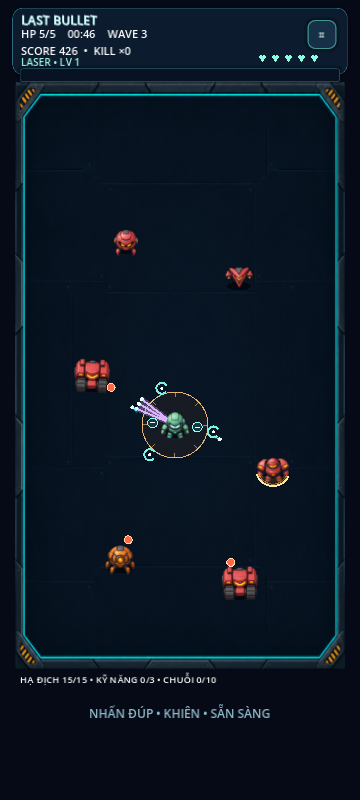

# LAST BULLET — v1.1.3
ZORVYKA Games • Auto Fire. Endless Chaos.

Godot 4 portrait robot survival shooter. Open `last-bullet/project.godot` from the repository root (or `project.godot` when already inside this directory). Validated with Godot 4.6.3.

## Robot cầm súng trong trận
Vũ khí đang trang bị xuất hiện trên tay robot, xoay theo hướng ngắm, có giật nòng nhẹ và chớp nòng ở đầu súng. Dùng đúng hình từ kho vũ khí, giữ nguyên sát thương và cách chơi. Xem [chi tiết](docs/HELD_WEAPONS.md).

## Đạn và hiệu ứng mới
Cả 12 vũ khí có đạn/vệt bay riêng, chớp nòng và hiệu ứng trúng mục tiêu. Kho vũ khí dùng cùng hình đạn với trong trận. Có chế độ giảm hiệu ứng; giữ nguyên sát thương và tiến trình. Xem [chi tiết](docs/PROJECTILE_FX.md).

## Hình ảnh pet & vũ khí mới
6 pet và 12 vũ khí được thay bằng tranh có chất liệu, ánh sáng và thiết kế riêng. Hình lớn hơn trong kho, trang chi tiết và pet trong trận; giữ nguyên tiến trình. Xem [chi tiết hình ảnh](docs/ILLUSTRATED_ART.md).

## Bản mới: hình ảnh, Việt–Anh và nâng hero
- Menu dạng lưới, 41 biểu tượng mới cho vũ khí/trang bị/pet/kỹ năng/vật phẩm; hiệu ứng đạn và kỹ năng riêng, số sát thương nổi.
- **Cài đặt → TIẾNG VIỆT / ENGLISH** đổi ngôn ngữ ngay và lưu lựa chọn.
- **Đồ & pet → Nâng nhân vật**: hero cấp 1–20 bằng vàng và lõi từ boss/càn quét; mỗi cấp thêm 2% sát thương, mỗi 5 cấp thêm 1 HP.
- **Vật phẩm hỗ trợ**: bộ sơ cứu hồi tối đa 3 HP giữa các phòng; không có nút dùng trong chiến đấu.
- Kho trang bị phân trang 12 món, lọc bốn ô. Xem [chi tiết bản mới](docs/VISUAL_LANGUAGE_HERO.md).

## Trang bị, pet và phó bản mới
Vào tab **ĐỒ & PET** → **HÀNH TRANG**: kho đồ/hợp nhất, pet, ba bộ lưu sẵn, thư viện, khu thử đồ và nhận vé càn quét ngày. Vũ khí vẫn ở tab VŨ KHÍ.

- **12 món / 4 ô** Giáp–Lõi–Bộ đẩy–Chip, thuộc ba bộ Băng hà/Thành trì/Hỏa ngục. Bốn độ hiếm Thường–Hiếm–Sử thi–Huyền thoại; nâng +0 đến +10 bằng vàng/vật liệu. Món +0 Thường ban đầu chưa tự mặc, để bạn chọn.
- **Hợp nhất 3→1, 100%** cùng tên/độ hiếm. Xem trước, tự chọn hoặc chọn tay. Giữ cấp cao nhất, hoàn đầu tư dư; bảo vệ nguyên liệu khóa/đang mặc, món chính đang mặc vẫn giữ nguyên. Không tự hợp nhất đồ rơi.
- **6 pet** tự hỗ trợ, không thêm nút hay hitbox. Bee khởi đầu, các pet còn lại mở cố định qua lần đầu 5 ải; tiến trình cũ đã qua ải được nhận tương ứng. Admin mở tất cả.
- **5 ải × 5 phòng**, Thường/Khó: giao tranh → tinh anh → tiếp tế → sự kiện → boss. Cần diệt đủ địch để đi tiếp, không còn chờ mốc thời gian gọi boss. Sao Thường/Khó riêng; Khó tăng tốc/độ dày đạn, không chỉ tăng HP.
- **Tiếp tục lượt chơi** ở đầu phòng, giữ build; đang chọn nâng cấp thì khôi phục đúng lựa chọn. Đồ/vàng đã nhận giữ lại khi thua. Nút Chơi ngay ưu tiên checkpoint; Bắt đầu mới thay lượt cũ.
- **Càn quét ×1/×5/×10** ải 3 sao đúng độ khó, dùng vé quét (5/ngày UTC, +1/nhiệm vụ). Nhận base replay gold/materials +1 vé summon/lượt và cơ hội rơi đồ; không thưởng lần đầu, không x2, không đổi sao/kỷ lục. Admin miễn vé/điều kiện.
- **Thư viện** hero/vũ khí/trang bị/pet/quái/boss: đã có/đã gặp phát sáng, chưa có tối và khóa; lọc tất cả/đã có/chưa có. **Khu thử đồ** bia đơn/nhóm/boss, đo DPS 10 giây không trả thưởng.

Đọc [hướng dẫn RPG đầy đủ](docs/RPG_SYSTEMS.md). [Hợp nhất](docs/previews/v1.0-fusion.png) · [Pet](docs/previews/v1.0-pets.png) · [Thư viện](docs/previews/v1.0-collection.png).

## Chơi trên điện thoại
Kéo ở bất kỳ vùng trống nào để di chuyển. Chạm đơn không kích hoạt; cần ẩn xuất hiện sau khi kéo ít nhất 12 pixel logic. Robot tự chọn địch gần trong tầm có đường bắn thông thoáng. Mặc định thả tay để bắn, kéo để né. Trong Cài đặt có thể bật BẮN KHI DI CHUYỂN nếu thích kiểu v0.8. Drone/lưỡi xoay vẫn hoạt động khi di chuyển. Đạn bạn màu sáng; né đạn đỏ/cam và vùng báo động của địch.

Nhấn đúp nhanh tại cùng một vùng trống để dùng kỹ năng (Space trên PC). Nút skill đã được ẩn; dòng nhỏ phía dưới chỉ báo sẵn sàng/hồi chiêu và không chặn kéo. Một lần chạm, kéo hoặc giữ lâu không kích hoạt skill. WASD/phím mũi tên di chuyển, Esc tạm dừng, F11 fullscreen cửa sổ desktop. Đã bỏ hoàn toàn gameplay Deflect, Perfect và viên đạn tồn tại mãi của v0.7.

## Kho vũ khí mới
Tab **VŨ KHÍ** ở thanh dưới sảnh → xem vũ khí → **TRANG BỊ MIỄN PHÍ**. 12 loại đều mở sẵn để thử, không trừ vàng/vé: súng trường, súng điện, băng, phun lửa, laser, shotgun, súng trinh sát, tên lửa dẫn đường, cung xuyên, boomerang, phóng lựu và súng độc.

Chọn vũ khí độc lập với robot; **DÙNG VŨ KHÍ ĐẶC TRƯNG ROBOT** trả về mặc định theo robot. Chỉ đổi ở sảnh, không đổi giữa trận. Lựa chọn được nhớ riêng theo profile. [Chi tiết cơ chế và phối hợp](docs/ARSENAL.md).



## Robot, vũ khí mặc định và kỹ năng
| Robot | Vũ khí | Kỹ năng |
|---|---|---|
| Aegis | Súng trường | Khiên 3 giây, tối đa 3 lần chặn |
| Volt | Súng điện nhanh, nảy 1 mục tiêu | Xung điện quanh robot |
| Frost | Đạn băng làm chậm | Đóng băng/làm chậm vùng quanh robot |
| Ember | Phun lửa tầm ngắn, gây cháy | Bùng nổ lửa quanh robot |
| Nova | Laser xuyên 3 mục tiêu bổ sung | 12 tia laser tỏa tròn |
| Cobalt | Shotgun 5 viên | 7 tên lửa có dẫn hướng, nổ lan |
| Scout | Súng trinh sát tầm xa | Lướt theo hướng di chuyển/ngắm, bất tử ngắn |

Cùng 5 HP cơ bản và hitbox; trang bị có thể tăng HP/tốc chạy; vũ khí/kỹ năng có khác biệt thực sự. Đạn thường hết tầm hoặc trúng tường/mục tiêu thì biến mất; nâng cấp xuyên/nảy chỉ thêm số lần hữu hạn, không có đạn bất tử.

## Nâng cấp và nhiệm vụ
16 nâng cấp: Hỏa lực, Tốc xạ, Đa đạn, Chí mạng, Đạn cháy, Xuyên giáp, Đạn liên hoàn, Hồi kỹ năng, Đạn chéo, Đạn sau lưng, Nảy tường, Nọc độc, Đạn lạnh, Đạn nổ, Drone hộ vệ, Lưỡi xoay. Băng + lửa tạo sốc nhiệt; độc và cháy gây sát thương độc lập. Drone bắn hỗ trợ, lưỡi xoay bảo vệ cận chiến. Chọn một trong tối đa ba thẻ khi lên cấp; giao tranh dừng, HUD ẩn và có lớp chặn chạm. Thông số trước → sau lấy từ vũ khí đang dùng.

Mỗi trận có 3 nhiệm vụ: hạ 15 địch, dùng 3 kỹ năng, chuỗi hạ 10 địch trong khoảng 3 giây giữa các lần hạ. Mỗi mục tiêu tự trả 15 vàng + 1 vé summon + 1 vé quét đúng một lần. Kết quả hiển thị điểm/thời gian/số địch, phần thưởng, chi tiết bắn/trúng/chí mạng/kỹ năng. X2 vàng nhận ngay một lần cho trận vừa xong, đúng profile; không có quảng cáo thật hay mô phỏng.

## Màn chơi và summon
Giữ Survival, sân có trụ (tên preset legacy Reflector), Blitz 90 giây và 5 phó bản Campaign theo phòng. Boss dùng bắn loạt, khiên theo chu kỳ, lao tới và vùng báo động; không bắt/trả đạn. [Chi tiết Campaign & Summon](docs/CAMPAIGN_SUMMON.md).

7 robot và 4 skin đạn hiện có được giữ. Summon x1/x10 bằng vé, tỷ lệ gốc 75/20/5, pity 10/50, robot trùng thành mảnh để đổi chọn. Skin đổi màu đạn thông thường, không tăng chỉ số; laser/băng/lửa vẫn giữ màu nhận diện.

## Admin, lưu và cập nhật
Avatar góc trái trên → Admin. Mở toàn bộ robot/skin/màn, summon miễn phí, test vàng, bật/tắt bất tử, max nâng cấp, bỏ hồi kỹ năng, phòng nâng cấp/địch/boss. Admin local tách tiến trình thường; không phải tài khoản máy chủ.

Giữ `user://records.cfg`, `records-admin.cfg`, `records-mode.cfg`. Vàng, robot, skin, summon/pity và campaign cũ không bị reset. Điểm Survival/Blitz của shooter dùng khóa mới, điểm gameplay cũ được giữ trong file nhưng không so kỷ lục chung.

Đóng dự án Godot trước khi cập nhật. Trên Termux:

```bash
cd ~/storage/downloads/GodotProjects/LAST-BULLET
git pull --ff-only
```

[Hướng dẫn Android/Termux](docs/ANDROID_TERMUX.md) · [Bàn giao](docs/SESSION_HANDOFF.md) · [Kiểm tra](docs/TEST_RESULTS.md) · [Cơ chế shooter](docs/SHOOTER.md)



Các tài liệu/ảnh phiên bản cũ là lịch sử. v0.8 thay thế luật một viên đạn/Deflect và robot chỉ khác ngoại hình. Bản này chưa benchmark điện thoại thật hoặc xuất APK.
