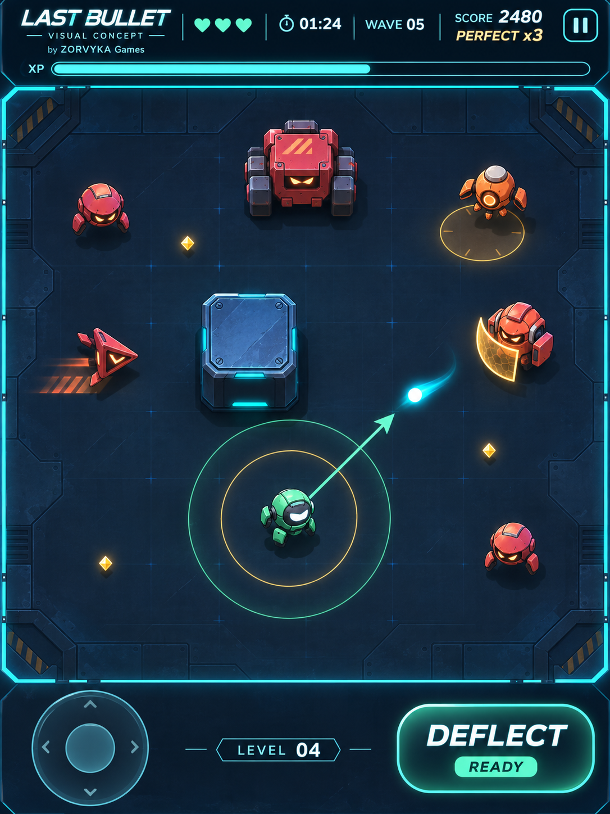

# LAST BULLET — Neon Arcade concept

## Tải ảnh
Mở [PNG gốc](last-bullet-neon-arcade-v1.png), chọn **Download raw file** ở góc trên bên phải; hoặc tải toàn repository bằng **Code → Download ZIP**.

## Hướng mỹ thuật
- Nền kim loại xanh đen, chi tiết sàn tiết chế, viền cyan.
- Nhân vật robot mint; địch đỏ cam có hình dáng và kích thước phân biệt rõ.
- Một viên đạn lõi trắng/cyan, vệt ngắn; vòng deflect mint và vòng Perfect vàng.
- Cột phản xạ kim loại, khiên vàng, vùng nguy hiểm dễ đọc.
- HUD gọn, joystick trái, nút Deflect lớn bên phải.

Đây là ảnh concept được tạo bằng AI để duyệt phong cách trước khi làm bộ sprite, hoạt ảnh và UI trong Godot. Các thông số, số tim, tỷ lệ và vị trí trong ảnh là minh họa mỹ thuật. Phiên bản game hiện tại vẫn là v0.3.0.
