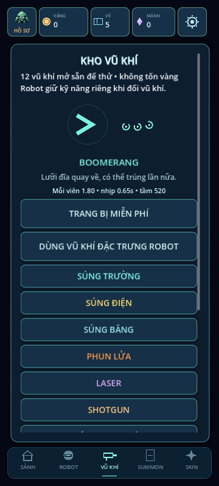
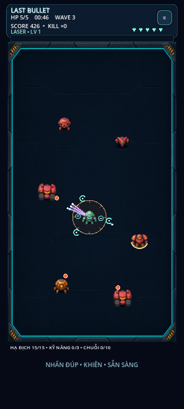
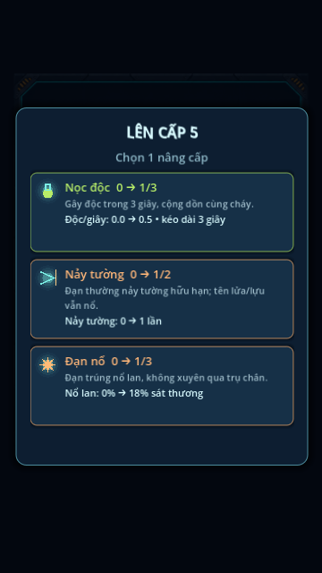

# Arsenal & build system — v0.9.0

User approved an Archer Hero-style auto-shooter direction with broad freedom to add weapon variety. This implementation uses the existing original robot/neon presentation and keeps drag-anywhere movement plus double-tap skills. No external game assets were copied.

## Controls and equipment
Default: drag to dodge, release to auto-aim/fire at the nearest visible enemy within range. Setting SHOOT WHILE MOVING restores continuous moving fire; it is saved independently per profile. A ready shot does not restart its cooldown while movement prevents firing, so release can fire promptly. Skill remains double-tap (Space on desktop), with the button hidden. Drones/orbit blades work during movement. No Deflect or permanent projectile returns.

Sảnh → VŨ KHÍ → inspect a weapon → TRANG BỊ MIỄN PHÍ. All 12 are available immediately with no currency/inventory debit. Loadout is independent of owned robot: robots determine active skill and optional default weapon, equipment chooses the primary weapon. -1 means follow the robot's original weapon. Changing gear is allowed only in the lobby. Profile key profile/weapon and settings/shoot_while_moving preserve each profile's choice; existing inventory, summon pity and stages remain unchanged.

## Weapons
| ID | Weapon | Main behavior |
|---|---|---|
| 0 | Rifle | Balanced single projectile |
| 1 | Electric gun | Fast, one innate chain to another visible enemy |
| 2 | Frost gun | Chills for 1.4s plus cold upgrades |
| 3 | Flamethrower | Short range, native burn .6 DPS plus burn upgrades |
| 4 | Pulse laser | Fast laser rounds, three additional penetrations |
| 5 | Shotgun | Five base pellets per volley |
| 6 | Scout rifle | Fast, long range |
| 7 | Rocket launcher | Capped homing turn, impact/range/wall explosion |
| 8 | Piercing bow | High-speed arrow, one extra penetration |
| 9 | Boomerang | Returns on range/edge/wall; can hit again on return, expires finitely |
| 10 | Grenade launcher | Wide explosion on collision/expiry |
| 11 | Venom gun | Native 1.2 poison DPS for 3s plus poison upgrades |

New weapon intervals: .95/.7/.65/1.05/.42 seconds for IDs7–11; damage 3/2.7/1.8/3.2/1.2, ranges 700/780/520/520/620. Original seven values remain in combat.gd. Primary weapon selection does not change the robot skill's base damage scaling. Preview body/projectile silhouettes are procedural vector art and share actual projectile drawing.

## Sixteen upgrades
Original slots0–7 retained: damage, rate, multishot, crit, burn, pierce, chain, skill cooldown. Additional slots:

- 8 diagonal pair, one level: two ±.55rad lanes at 70% damage each.
- 9 back shot, one level: opposite-direction projectile at 80% damage.
- 10 wall ricochet, two levels: finite bounces against cover; rockets/grenades still explode, boomerangs return. Reaching the outer arena edge retires ordinary bullets rather than leaving immortal objects.
- 11 poison, three levels: +.5 poison DPS/level for 3s; adds to the venom gun's native1.2.
- 12 cold, three levels: slows enemy movement to45%; native Frost duration1.4s plus .4s/level; other weapons .6+.4*level seconds. Slows do not permanently freeze a boss.
- 13 blast, three levels: contact splash at18% damage/level, radius45+12*level; native explosive contact splash starts at65%, adding18%/level. Rocket/grenade expiry splash starts at80%. All splash respects line of sight, including the visible side of wall impacts.
- 14 drones, two levels: one/two orbiting drones, shoot every .8s at55% primary damage while moving or idle; target selection respects cover.
- 15 orbit blades, three levels: one to three blades at radius78, 65% primary damage, .45s per-enemy contact cooldown; respect walls between player and enemy.

Chilled + burning enemies trigger a75-radius thermal burst for70% triggering projectile damage, with a1.5s lock per enemy. Poison and burn are independent statuses; reapplication refreshes duration and keeps the stronger power instead of stacking unbounded status objects. Existing native elemental weapons receive additive upgrades, not a no-op upgrade. All16 before/after descriptions use equipped weapon stats; offers/caps are unchanged in principle, maxed choices excluded.

## Limits and validation
Still one projectile renderer, max160 friendly/180 hostile/32 flashes. Flash insertions enforce bounds even when a boss kill stops simulation mid-frame. Orbit damage uses expiring per-enemy cooldowns, no new per-shot or per-status scene nodes. Pause/upgrade/results freeze all combat advancement; new run clears state.

Tests arsenal and arsenal_stress cover all12 weapons, free/profile-isolated equip, moving/stationary modes, true boomerang return hits, wall bounces/splash LOS, additive native elements, poison/thermal damage, drones/blades and pause. Stress:12 weapons×45 simulated seconds with all16 upgrades and mixed robot skills, cover, both movement modes; the older seven-robot stress adds720s. Current13 suites also retain campaign, save/summon, reward and double-tap checks. These do not establish real-phone FPS or difficulty balance.

