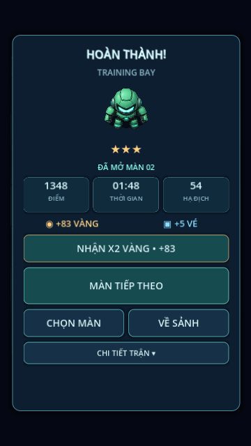

# Mobile results screen

2026-11-05: Implemented the approved mobile results redesign. Win/failure headline, selected robot with a short fade, campaign stars and next-stage notice, three stat tiles (score/time/kills), a gold/ticket reward row, instant once-only x2 gold, prominent retry/next-stage CTA and smaller stage-select/home buttons. Perfect/streak/deflect details are collapsed by default below the actions. Summon, wallet balance and shop upsell removed from this screen.

Displayed gold includes mission gold already granted during the run; after x2 it shows the doubled total. Tickets show only those earned this run. Zero-gold runs have no x2 button. The existing result_paid/double_claimed/profile guards remain authoritative; reopening the page does not grant rewards. Last campaign stage offers retry instead of a nonexistent next stage. Admin and normal saves stay isolated. No ad providers, mock ads or payments were introduced.

Validated on Godot 4.6.3 Linux: tests/results.gd (failure/win routes, zero-gold button absence, details toggle, once-only x2, next-stage action, Blitz retry), campaign, features and lobby suites. Rendered failure and success at 360×640 and success at 360×800 via Xvfb/Mesa, checked for readability/overflow. Physical S23 Ultra touch comfort awaits user testing after pull.

