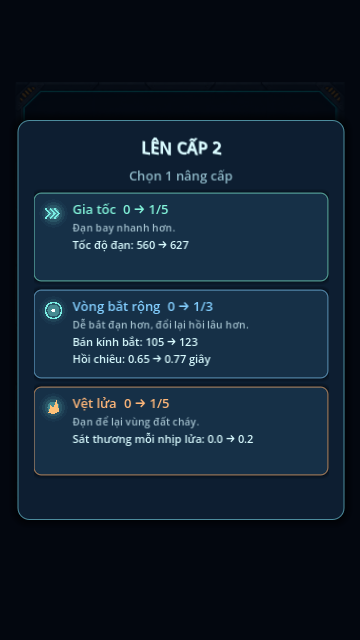

# Mobile upgrade selection

2026-11-05. Implements the approved compact centered level-up panel: Vietnamese heading and names, three vertical cards, large existing upgrade icons, category colors (damage orange, defense blue, speed/steering mint), current → next level and concrete before/after values. Colors describe function, not rarity. Wide Catch explicitly includes its cooldown tradeoff (or the active admin no-cooldown override). Cards use existing press feedback and choose on normal button release; one choice immediately resumes play without an extra confirmation step.

The 800-logical-pixel-high panel centers within safe margins and retains scrolling as a fallback. A dark translucent full-screen input blocker dims the arena; no expensive blur shader was added. HUD, missions, controls and toasts hide during selection. Combat remains paused; entering/leaving resets the joystick, and state/offer guards prevent repeated selection. UI children ignore pointer input so card buttons receive touches, while the backdrop consumes blank touches. Normal keyboard and drag-anywhere movement resume after selection; a tap alone still does not activate movement.

Before/after numbers derive from current upgrades and the existing combat formulas, without changing balance, caps or random-offer rules. Fire damage is per tick; steering is radians/second while idle, speed values are base bullet speed before transient boosts, and Bank Shot shows maximum wall-charge damage. All-max behavior remains a one-HP heal.

Validation: Godot 4.6.3 import and tests/upgrade_ui.gd pass. The new test covers safe compact layout at 1280/1600/1800 logical heights, pause, hidden HUD, touch isolation, all eight delta descriptions, selecting once and excluding maxed upgrades. Features, campaign, results and admin_mobile suites pass as well. Rendered at 360×640 and 360×800 with Xvfb/Mesa, including supplied safe insets and the multiline Wide Catch card. Physical Android touch/comfort confirmation remains for the user.

